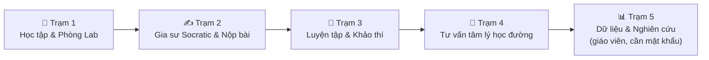

# Gia Sư AI (GSAI) — Hệ sinh thái 5 trạm hỗ trợ học sinh tự học

> **Đề tài KHKT dành cho học sinh trung học năm 2026**
> Trường THPT Tân Hiệp (An Giang) · Tác giả: **Thầy Phan Minh Trí**
> Triết lý: **"Dưỡng thiện tâm – Ươm nhân tài"**
> Phạm vi: **Lớp 6–12** · Chương trình GDPT 2018 · Bộ sách *Kết nối tri thức với cuộc sống* (KNTT)

📘 **Hướng dẫn sử dụng chi tiết từng trạm, từng nút:** [docs/HUONG_DAN_SU_DUNG.md](docs/HUONG_DAN_SU_DUNG.md)

---

## 1. GSAI là gì?

GSAI là ứng dụng web (Streamlit) giúp học sinh **tự học theo bài**, **được gợi mở kiểu Socratic** (không giải hộ), **luyện đề theo đúng cấu trúc**, **được lắng nghe khi gặp khó khăn tâm lý học đường**, và giúp giáo viên **theo dõi dữ liệu học tập** phục vụ nghiên cứu.

| Hạng mục | Liên kết |
| :--- | :--- |
| Kho mã nguồn (bản dự phòng) | https://github.com/pmtgiaitichk15ai2025/DUPHONGKHKT2026 |
| Web app | https://duphongkhkt2026.streamlit.app |
| File chạy chính | `app.py` (các alias `Home.py`, `main.py`, `streamlit_app.py` cùng nội dung) |

---

## 2. Năm trạm



| Trạm | Dành cho | Làm được gì |
| :---: | :--- | :--- |
| **📖 1** | Học sinh | Soạn bài học theo chủ đề, phiếu bài học / infographic, vấn đáp Socratic, trắc nghiệm kiểm tra nhanh, Phòng Lab mô phỏng |
| **✍️ 2** | Học sinh | Chụp / tải ảnh bài làm, Thầy AI nhận xét và gợi mở từng bước, bản đồ lỗ hổng kiến thức |
| **📝 3** | Học sinh & giáo viên | Một nút **🚀 Sinh đề** (kho đủ thì dùng kho, thiếu thì AI sinh đủ), làm bài có giờ, chấm tức thì, xuất PDF / LaTeX / Word / Azota |
| **💚 4** | Học sinh | Trò chuyện, được lắng nghe; giáo viên ghi nhận chỉ số tiến bộ (WHO-5, check-in) — **không phải chẩn đoán lâm sàng** |
| **📊 5** | Giáo viên | Nhật ký, hồ sơ học sinh, phân tích trước–sau, đo lường đề, xuất dữ liệu ẩn danh — **cần mật khẩu `ADMIN_PASS`** |

## 3. Môn học theo lớp

| Cấp | Lớp | Môn |
| :--- | :--- | :--- |
| THCS | 6–9 | Toán học, Ngữ văn, Tiếng Anh, Tin học, Công nghệ, Khoa học tự nhiên, Lịch sử & Địa lý, Giáo dục công dân |
| THPT | 10–12 | Toán học, Ngữ văn, Tiếng Anh, Tin học, Công nghệ, Vật lý, Hóa học, Sinh học, Lịch sử, Địa lý, Giáo dục kinh tế và pháp luật |

---

## 4. Cài đặt và chạy trên máy (local)

**Yêu cầu:** Python 3.10 hoặc 3.11 (CI kiểm trên hai bản này), máy có ≥ 8 GB RAM.

```bash
git clone https://github.com/pmtgiaitichk15ai2025/DUPHONGKHKT2026.git
```

```bash
cd DUPHONGKHKT2026
```

```bash
python -m pip install -r requirements.txt
```

Tạo file `.streamlit/secrets.toml` (**không** đưa file này lên GitHub):

```toml
GEMINI_API_KEY = "khóa Gemini của bạn"
ADMIN_PASS = "mật khẩu giáo viên (hoặc dạng sha256:...)"
```

Chạy app:

```bash
streamlit run app.py
```

Trình duyệt mở `http://localhost:8501`.

### Các khóa cấu hình (Secrets) tùy chọn

| Khóa | Ý nghĩa |
| :--- | :--- |
| `GEMINI_API_KEY` | Khóa AI dùng chung. Không có thì học sinh tự dán khóa ở thanh bên |
| `ADMIN_PASS` | Mật khẩu mở Trạm 5. Thiếu thì Trạm 5 bị khóa |
| `MAX_AI_CALLS_PER_SESSION` | Giới hạn số lượt gọi AI mỗi phiên |
| `GOOGLE_SHEET_URL`, `GOOGLE_SHEET_VIEW_URL`, `SHEET_WEBHOOK_TOKEN` | Đồng bộ nhật ký sang Google Sheets (nếu dùng) |
| `SUPABASE_URL`, `SUPABASE_KEY` | Đồng bộ cơ sở dữ liệu đám mây (nếu dùng) |
| `GSAI_VOICE_PUBLIC_URL` | Dịch vụ giọng đọc riêng (nếu đã triển khai) |

## 5. Kiểm thử

Chạy giống CI (khoảng 20 phút trên GitHub, có thể lâu hơn trên máy cá nhân):

```bash
python -m unittest discover -s tests -p "test_*.py"
```

Test giao diện dùng AI giả và tự ghi đề giả vào thư mục tạm (`GSAI_EXAM_CACHE_DIR`), không làm bẩn `data/exam_cache`.

## 6. Cài như ứng dụng trên điện thoại (PWA)

- **Android (Chrome/Edge):** menu ⋮ → *Thêm vào màn hình chính*.
- **iPhone (Safari):** nút Chia sẻ → *Thêm vào MH chính*.
- **Máy tính (Chrome/Edge):** biểu tượng cài đặt trên thanh địa chỉ.

## 7. Cấu trúc thư mục chính

```
app.py                 giao diện 5 trạm
real_exam_engine.py    kho đề, trộn đề, cache
services/              chấm điểm, chương trình, tư vấn, hồ sơ cá nhân, ...
data/                  kho đề nén XZ, chương trình, neo pháp lý
docs/                  hướng dẫn sử dụng và tài liệu nội bộ
tests/                 bộ kiểm thử unittest
scripts/               kiểm tra nhanh (smoke)
```

## 8. Quyền riêng tư và giới hạn — cần đọc

- Nội dung học sinh gõ hoặc chụp có thể được **gửi tới Google Gemini** để AI phản hồi.
- Hồ sơ cá nhân đầy đủ lưu trên **thiết bị của người dùng** (file `.gsai.xz`); người dùng tự tải, khôi phục hoặc xóa.
- Dữ liệu xuất cho nghiên cứu dùng mã `HS-…`, bỏ họ tên và nội dung tư vấn thô.
- Đề và bài do AI sinh **cần giáo viên duyệt** trước khi dùng cho đánh giá chính thức.
- Trạm 4 **không thay thế** chuyên gia tâm lý / bác sĩ. Khi có dấu hiệu nguy hiểm, cần báo ngay cho giáo viên, gia đình hoặc đường dây hỗ trợ.
- Số lượng trong kho đề là **số bản ghi / lượt câu**, chưa phải số câu độc nhất đã thẩm định.

---

*Dưỡng thiện tâm – Ươm nhân tài · Mỗi bước tiến của học sinh là niềm hạnh phúc lớn nhất của Người Thầy.*
